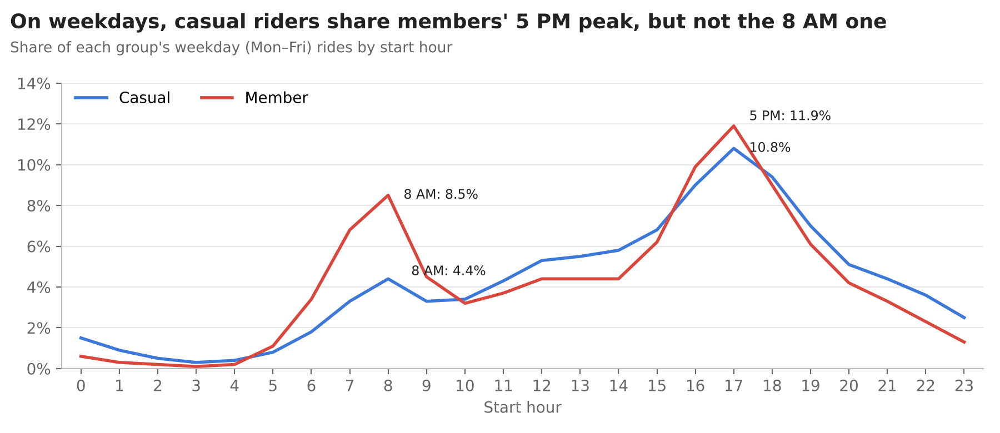

# Cyclistic Bike-Share Analysis: How Do Members and Casual Riders Differ?

**Google Data Analytics Certificate – Capstone Case Study 1**
Tools: Excel · Google BigQuery (SQL) · Google Sheets

## Business question
Cyclistic, a Chicago bike-share company, wants to convert casual riders into annual members (its most profitable segment, according to the case brief). This project analyzes **5.9 million rides (Sep 2025 – Aug 2026)** to understand how the two groups use the service differently and to recommend a conversion strategy.

## Key findings
- **Members take 65% of rides** and ride in a commuting pattern: weekdays, with peaks at 8 AM and 5 PM.
- **Casual rides last ~48% longer** (17.8 vs. 12.0 min), peak on weekends and are far more seasonal: they fall **14x** from July to January, versus 5x for members.
- Yet **63% of casual rides happen on weekdays**, and **144K–526K** of them fit a commuting pattern (morning peak only vs. morning + afternoon peaks).
- On weekday mornings, many casual rides start **next to Metra commuter-rail terminals** and in residential and office areas.



## Recommendations
1. **Target casual riders who already commute**, at Metra terminals and business districts, with digital in-app messages.
2. **Run the campaign from spring to early fall**, ahead of the winter drop in casual ridership.
3. **Position membership as one pass for commuting and leisure**, aimed at weekend casual riders.

## Process
| Step | What was done |
|---|---|
| Explore | One month (Sep 2025) explored in Excel to test quality checks and form hypotheses |
| Load | 12 monthly files loaded into BigQuery and combined with `UNION ALL` (6.1M raw rows, beyond Excel's limit; 5.9M after cleaning) |
| Clean | Removed rides outside the period, 35 cross-file duplicates, rides under 1 minute and rides of 12+ hours (2.7% of rows); kept e-bike rides with no station |
| Validate | Row counts reconciled between Excel, BigQuery and the source files |
| Analyze | Aggregations by rider type, month, day of week, hour and station; shares with window functions |
| Share | Charts in Google Sheets; full report in PDF |

## Repository structure
```
report/   Full case study report (PDF)
sql/      All queries, numbered in execution order (01–13)
charts/   Final visualizations
```

## Data
Public trip data from [Divvy](https://divvybikes.com/system-data), Chicago's bike-share system, provided by Motivate International Inc. under the [Divvy Data License Agreement](https://divvybikes.com/data-license-agreement). Cyclistic is a fictional company. Raw data is not included in this repository due to its size; it can be downloaded from the source.

**Limitations:** no rider IDs (the analysis compares rides, not people), no pricing and no pass type.

## Author
Rafael Couto · [LinkedIn](https://www.linkedin.com/in/couto-rafael)
